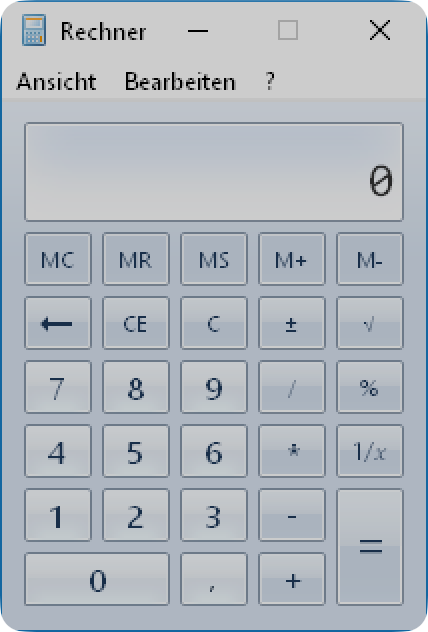
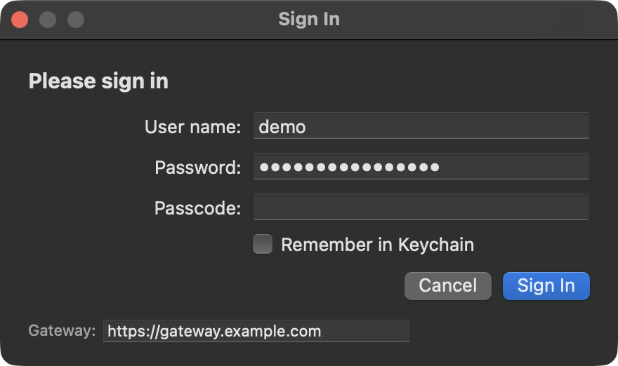
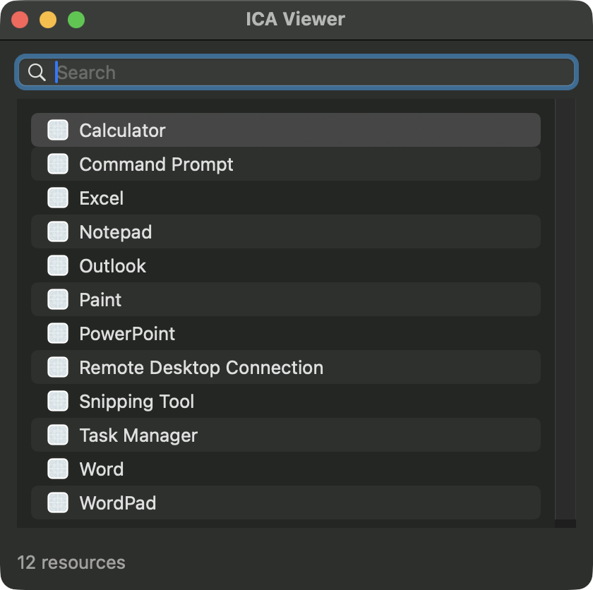
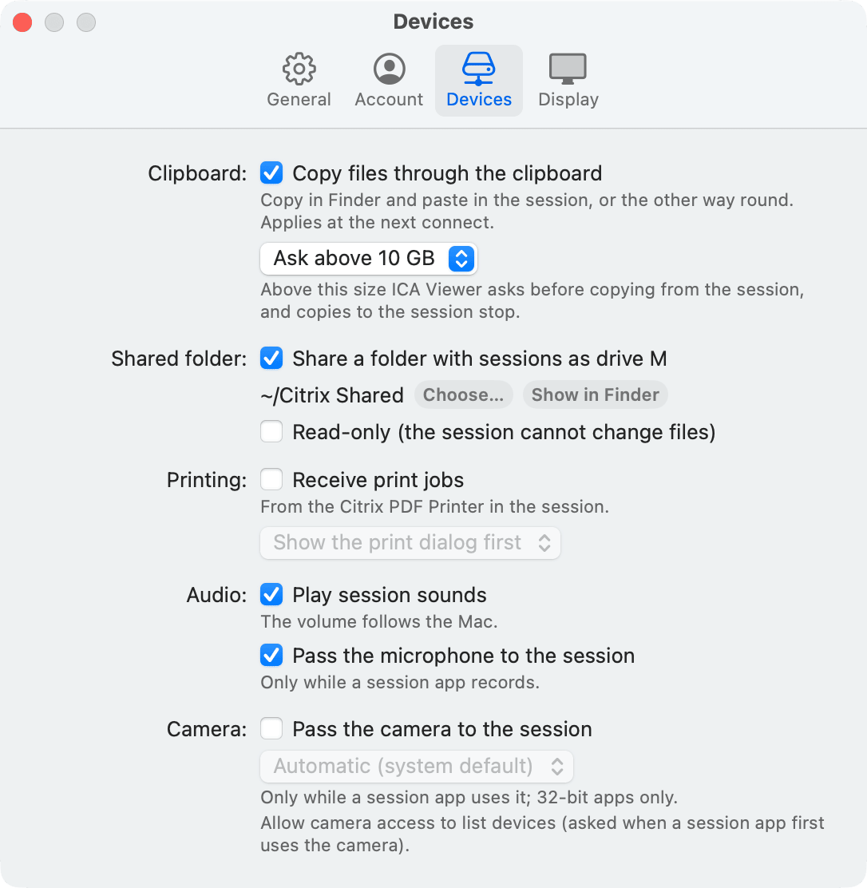

# swift-ica-client

ICAViewer, an independent, native macOS client for published applications delivered over the ICA
protocol, written in Swift. Each seamless remote window becomes a real macOS window: an
`AXStandardWindow` with a working minimize button and a single (remote) title bar. Cmd-Tab, Mission
Control and third-party window switchers handle them like local windows.

This is a personal interoperability project, built for and tested against one environment
(NetScaler Gateway with nFactor, StoreFront, VDAs serving classic Thinwire). It is not a product
and not a replacement for the official client. Expect gaps; see [Status](#status).

> **Not affiliated with Citrix.** Citrix, ICA, HDX, NetScaler and StoreFront are trademarks of
> Cloud Software Group, Inc. They are used here only to describe what this software
> interoperates with. This project contains no code from any Citrix product.

<p align="center">
  
</p>

## Screenshots

| Sign-in (generated from the gateway's form) | App launcher |
|---|---|
|  |  |

| Settings (Devices pane) | Reconnecting after a network drop |
|---|---|
|  | <br><br> |

The calculator above is a live session, and the Settings image is from the lab; the other images use the app's demo mode
(`ICAVIEWER_DEMO=1`) with example data.

## What works

Verified live means: run against a test lab (a StoreFront site with Windows VDAs), in a macOS VM or headless.

- **Sign-in:** a gateway with an nFactor form (user name, password, TOTP passcode), or a StoreFront
  store directly, without a gateway. The login window is generated from the server's own form. Sign
  Out (File menu) ends the store and gateway sessions at the servers.
- **Saved logins:** optional, in the macOS Keychain with Touch ID or the Mac password required.
  The release build is signed with a Keychain access group, so the items are bound to this Mac and
  Touch ID is enforced by the Keychain; builds without it use the login keychain (see Build and run).
- **Seamless apps:** every remote window is a real Mac window, with one Dock and Cmd-Tab entry per
  app, its own menu bar (Cmd-Q quits that app only), and the launcher on ⌃⌥⌘L. Several apps share
  one session. A published desktop opens in one window (fixed size; no multi-monitor desktop).
- **Sessions survive trouble:** session reliability carries short network drops (dimmed windows and a
  countdown), longer drops reconnect automatically, and the launcher offers to reconnect
  disconnected sessions. The Connection Center lists sessions (reconnect, disconnect, log off) and
  shows which features the server refuses ("blocked by server policy") and an unencrypted
  connection.
- **Graphics and displays:** Thinwire classic and H.264 (4:2:0 decode verified), Retina-sharp 2x
  with a 1x fallback, separate Windows and client scaling.
- **Keyboard:** scancodes and Unicode, Cmd shortcuts sent as Ctrl; the Mac's keyboard layout is
  announced at sign-in, and after a layout switch printable keys go as text (verified headless).
- **Clipboard:** text and images both ways; rich text (RTF, also with a picture) both ways with
  WordPad and LibreOffice Writer; files and folders between Finder and File Explorer both ways, with a
  progress window for large copies. HTML does not cross (the server filters it). Large copies from
  the session are slow on servers that pace file transfers.
- **Client drive:** one shared folder as drive M (verified live; files written by the session get the
  quarantine flag).
- **Printing:** the session's PDF printer delivers a PDF to the Mac (verified to a valid PDF; off by
  default). **Audio playback** (verified live).
- **Interface:** Settings in four panes that apply at once, Mac-style menus, VoiceOver labels,
  contrast settings, English and German. Help opens the [user manual](manual/README.md).
- **Security:** server XML never expands entities, host input cannot crash the viewer, no HTTPS to
  HTTP downgrade, a gateway account never connects in plain TCP, and release builds ignore test
  switches in the environment.
- **Report a Problem** (Help menu): builds a scrubbed report and a prefilled GitHub issue; see
  [Reporting problems](#reporting-problems).

## User manual

A full user manual with screenshots is in [manual/](manual/README.md): installation, signing in, the launcher, remote apps, clipboard, drives, printing, audio and webcam, displays, the Connection Center, reconnect, every setting, troubleshooting and privacy notes. It is regenerated for every release; the release's PDF is attached to the GitHub release.

## Status

See [FEATURES.md](FEATURES.md) for a feature-by-feature comparison with the official clients.

Implemented but not verified live: the **microphone** (macOS asks for permission; the test servers'
VDA never opened the capture device, so nothing has been recorded) and the **webcam** (the host
handshake works, no real camera has been tried; only 32-bit host apps can use it). The gateway step
of Sign Out was not run against a live gateway, and the keyboard layout switch has been checked
against the protocol, not yet by hand in the app. Only seamless app launches and one published
desktop were exercised.

Not implemented: SAML, smart card and FIDO2 sign-in, USB devices, links opening on the Mac, file
transfer beyond clipboard files and the shared folder, Teams optimization. HDX over UDP exists as an
experimental, switched-off code path and is not part of this release.

## Reporting problems

Help > Report a Problem... opens a dialog for a free-text description and a few options (environment,
settings without secrets, log of the last 10, 30 or 60 minutes, app names hidden by default). It
shows a scrubbed preview of exactly what the report contains: gateway and store hosts, user names,
IP addresses, tokens and tickets, e-mail addresses, home paths and app names are removed or replaced.
Nothing is sent automatically. You review the preview first; the dialog then opens a prefilled GitHub
issue in your browser and saves the full report as a file you can attach. Issues are public, so check
the preview before you submit. Separately, ICAViewer keeps a local log in `~/Library/Logs/ICAViewer`
(readable only by you, not scrubbed); set `ICA_LOG_FILE=0` to turn it off.

## Requirements

- macOS 14 or later, Swift 6 toolchain (Xcode 16 or newer).
- A StoreFront store, directly or behind a NetScaler Gateway with an ExplicitForms nFactor policy.

## Install

Download `swift-ica-client-<version>.dmg` from the
[Releases](https://github.com/JanHaan/swift-ica-client/releases) page, open it and drag ICAViewer
to Applications. The app is a universal binary (Apple silicon and Intel), signed with a
Developer ID and notarized by Apple, so it opens without Gatekeeper warnings. Each release lists
the DMG's SHA-256.

## Build and run

```sh
swift build
swift test
scripts/bundle.sh            # release build wrapped as .build/ICAViewer.app
open .build/ICAViewer.app
```

`bundle.sh` signs ad hoc by default. With a provisioning profile at
`signing/ICAViewer.provisionprofile` it signs with your Apple Development identity and the
Keychain entitlements, which enables Keychain-enforced Touch ID protection
(`scripts/fetch-profile.sh` describes how to obtain one; profiles never go into git). Set your own
team in `signing/project.yml`.

The app version comes from the `VERSION` file (`ICA_VERSION` overrides it); the build number is the git
commit count, and the About panel also shows the short commit hash.

On first start ICAViewer asks for the gateway URL and your credentials.

`scripts/make-dmg.sh [version]` builds a universal release DMG into `.build/dist/` (ad hoc signed by
default; with `ICA_SIGN=developer-id ICA_NOTARY_PROFILE=<notarytool keychain profile>` it signs with
your Developer ID, notarizes and staples).

## Command-line tool

`icactl` drives the same library without a UI, mainly for testing:

```sh
swift run icactl login                  # gateway logon, cookies saved in .session/
swift run icactl session "<resource>"   # headless session, captures channel data to .session/
swift run icactl droptest "<resource>"  # session with one forced link drop and a resume
```

Configuration for automated runs comes from a `.env` file in the package root (git-ignored):

```sh
CITRIX_GATEWAY_URL=https://gateway.example.com
CITRIX_USERNAME=...
CITRIX_PASSWORD=...
CITRIX_TOTP_SECRET=...      # base32; optional, otherwise you are prompted for the passcode
CITRIX_DOMAIN=...           # optional
```

`.session/` holds cookies, launch files and captures. It is git-ignored and must never be shared:
it contains session tickets and screen content.

## Layout

| Path | Contents |
|---|---|
| `Sources/ICAKit` | Gateway/store client, TLS, CGP, Winstation driver, Thinwire, TWI |
| `Sources/ICAViewer` | AppKit app: login, settings, remote windows, input |
| `Sources/icactl` | Command-line tool |
| `Tests/ICAKitTests` | Unit tests and offline end-to-end tests |
| `scripts`, `signing` | App bundling and code signing |

## How this was made

The protocol knowledge was obtained for interoperability under Art. 6 of Directive 2009/24/EC
(§69e of the German Copyright Act), from a lawfully obtained client, from public documentation, and
from observing the author's own sessions. The implementation was written independently from
those notes. The notes themselves are not published.

## License

Dual-licensed under [MIT](LICENSE-MIT) or [Apache-2.0](LICENSE-APACHE), at your option. See
[LICENSE](LICENSE).
