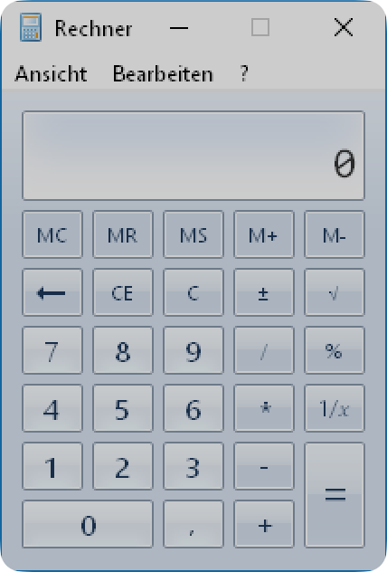
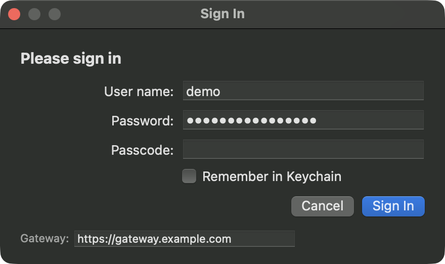
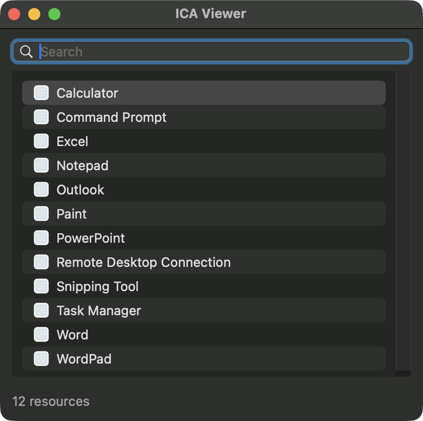
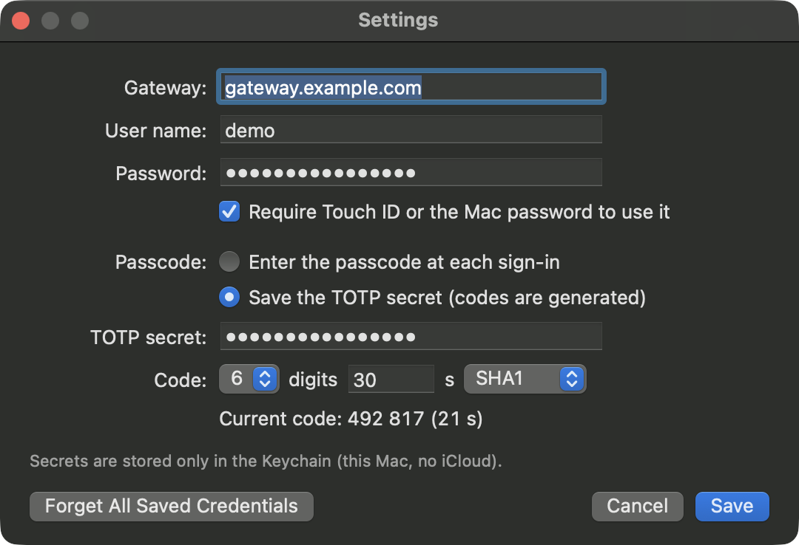

# swift-ica-client

ICAViewer, an independent, native macOS client for published applications delivered over the ICA
protocol, written in Swift. Each seamless remote window becomes a real macOS window: an
`AXStandardWindow` with a working minimize button and a single (remote) title bar. Cmd-Tab, Mission
Control and third-party window switchers handle them like local windows.

This is a personal interoperability project, built for and tested against one environment
(NetScaler Gateway with nFactor, StoreFront, VDAs serving classic Thinwire). It is not a product
and not a replacement for the official client. Expect gaps; see [Status](#status).

> **Not affiliated with Citrix.** Citrix, ICA, HDX, NetScaler and StoreFront are trademarks of
> Cloud Software Group, Inc. They are used here only to describe what this software
> interoperates with. This project contains no code from any Citrix product.

<p align="center">
  
</p>

## Screenshots

| Sign-in (generated from the gateway's form) | App launcher |
|---|---|
|  |  |

| Settings and Keychain storage | Reconnecting after a network drop |
|---|---|
|  | <br><br> |

The calculator above is a live session; the other images use the app's demo mode
(`ICAVIEWER_DEMO=1`) with example data.

## What works

- Gateway logon (nFactor ExplicitForms with username, password and TOTP passcode), store resource
  list and launch, from a native login window generated from the gateway's own form definition.
- Optional credential storage in the macOS Keychain (this device only), with Touch ID or password
  required before the TOTP secret is read.
- TLS to the gateway, CGP with session reliability: the session survives network drops, Wi-Fi
  changes and short sleeps (up to the server's reliability timeout, typically 180 s), with dimmed
  windows and a countdown while reconnecting.
- ICA handshake, V3 framing, keyboard (scancodes) and mouse input.
- Thinwire classic graphics (the GDI-style command set, caches, pointer shapes), double-buffered,
  with an adaptive frame-rate limit. An H.264 path (VideoToolbox) exists but is untested.
- Seamless windows (TWI): native windows and popups, local move and resize without round trips,
  minimise, multi-monitor sessions spanning all screens.
- Reconnecting to an existing disconnected session. A start that drops early is retried a few times.
- Display scaling: Windows scaling and client scaling are set separately. The Auto default is
  Retina-sharp at normal size (2x / 200 %), chosen per screen, and falls back to 1x when the
  session would exceed the protocol's size limit (5120x4096). Verified live on a single Retina
  screen; the limit with several screens is not yet verified live.
- Session management: a Connection Center window (Cmd-Shift-C) lists sessions and can reconnect,
  disconnect or log them off. Cmd-Q asks whether to Disconnect (default) or Log off. The store
  operations behind it are verified live; the window itself has not yet been reviewed by a user.
- Clipboard: text works both ways in the app (verified live).

## Status

See [FEATURES.md](FEATURES.md) for a feature-by-feature comparison with the official clients.

Implemented but not yet verified live:

- Clipboard HTML, RTF and images.
- Client drive mapping: one shared folder (default `~/Citrix Shared`, read-write, strictly
  confined, files written by the session get the quarantine flag). Security-reviewed; the test site
  does not redirect client drives.
- Printing: PDF printing through the host's PDF printer to the macOS print panel. Off by default;
  the test site creates no client printers.
- Audio playback (PCM, Opus). The channel negotiation works live; actual sound output is not yet
  verified.

Not implemented yet: microphone and webcam, one Dock entry per remote app (designed), session
sharing, EDT/UDP, other authentication methods (SAML, smart card, FIDO2), file transfer beyond the
shared folder. H.264 is untested. Only seamless app launches are exercised; full desktops are
untested.

## Requirements

- macOS 14 or later, Swift 6 toolchain (Xcode 16 or newer).
- An environment reachable through a NetScaler Gateway with an ExplicitForms nFactor policy.

## Install

Download `swift-ica-client-<version>.dmg` from the
[Releases](https://github.com/JanHaan/swift-ica-client/releases) page, open it and drag ICAViewer
to Applications. The app is a universal binary (Apple silicon and Intel), signed with a
Developer ID and notarized by Apple, so it opens without Gatekeeper warnings. Each release lists
the DMG's SHA-256.

## Build and run

```sh
swift build
swift test
scripts/bundle.sh            # release build wrapped as .build/ICAViewer.app
open .build/ICAViewer.app
```

`bundle.sh` signs ad hoc by default. With a provisioning profile at
`signing/ICAViewer.provisionprofile` it signs with your Apple Development identity and the
Keychain entitlements, which enables Keychain-enforced Touch ID protection
(`scripts/fetch-profile.sh` describes how to obtain one; profiles never go into git). Set your own
team in `signing/project.yml`.

On first start ICAViewer asks for the gateway URL and your credentials.

`scripts/make-dmg.sh [version]` builds a universal release DMG into `.build/dist/` (ad hoc signed by
default; with `ICA_SIGN=developer-id ICA_NOTARY_PROFILE=<notarytool keychain profile>` it signs with
your Developer ID, notarizes and staples).

## Command-line tool

`icactl` drives the same library without a UI, mainly for testing:

```sh
swift run icactl login                  # gateway logon, cookies saved in .session/
swift run icactl session "<resource>"   # headless session, captures channel data to .session/
swift run icactl droptest "<resource>"  # session with one forced link drop and a resume
```

Configuration for automated runs comes from a `.env` file in the package root (git-ignored):

```sh
CITRIX_GATEWAY_URL=https://gateway.example.com
CITRIX_USERNAME=...
CITRIX_PASSWORD=...
CITRIX_TOTP_SECRET=...      # base32; optional, otherwise you are prompted for the passcode
CITRIX_DOMAIN=...           # optional
```

`.session/` holds cookies, launch files and captures. It is git-ignored and must never be shared:
it contains session tickets and screen content.

## Layout

| Path | Contents |
|---|---|
| `Sources/ICAKit` | Gateway/store client, TLS, CGP, Winstation driver, Thinwire, TWI |
| `Sources/ICAViewer` | AppKit app: login, settings, remote windows, input |
| `Sources/icactl` | Command-line tool |
| `Tests/ICAKitTests` | Unit tests and offline end-to-end tests |
| `scripts`, `signing` | App bundling and code signing |

## How this was made

The protocol knowledge was obtained for interoperability under Art. 6 of Directive 2009/24/EC
(§69e of the German Copyright Act), from a lawfully obtained client, from public documentation, and
from observing the author's own sessions. The implementation was written independently from
those notes. The notes themselves are not published.

## License

Dual-licensed under [MIT](LICENSE-MIT) or [Apache-2.0](LICENSE-APACHE), at your option. See
[LICENSE](LICENSE).
