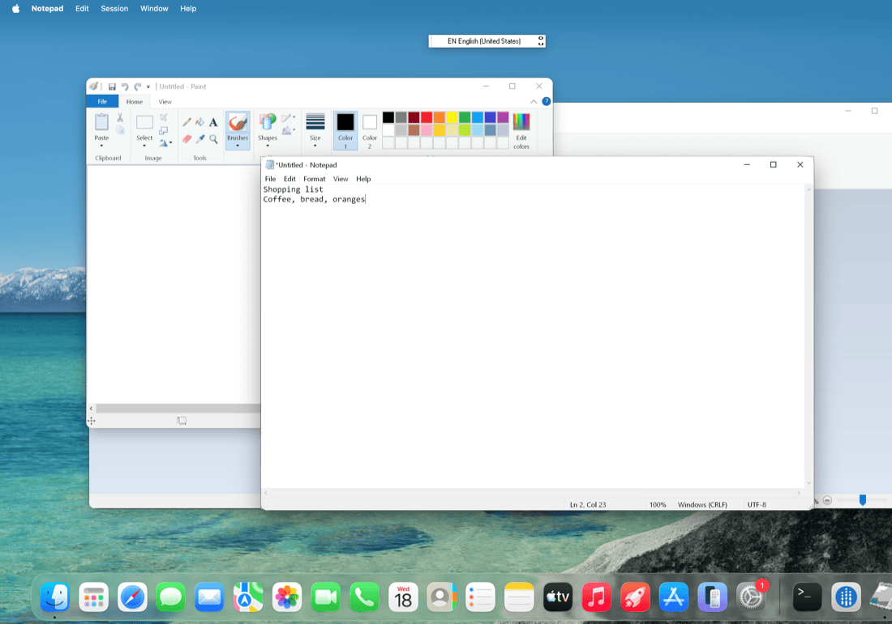
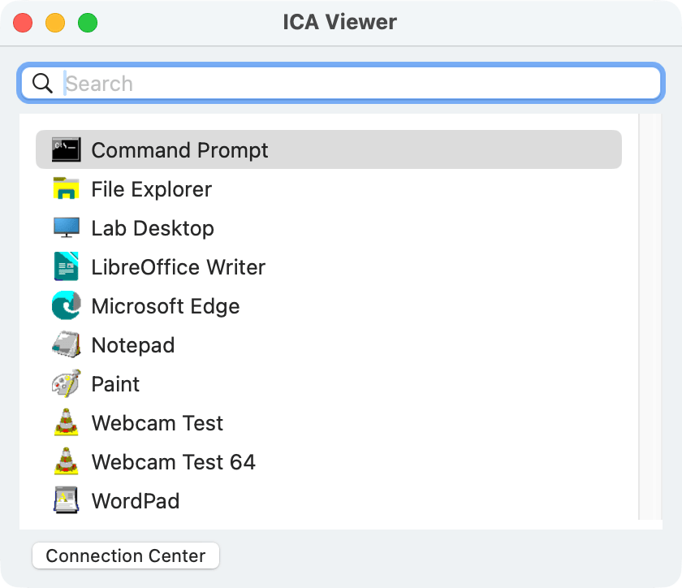

# swift-ica-client

ICAViewer is an independent, native macOS client for published Windows apps delivered over the ICA
protocol (Citrix), written in Swift. Each remote window becomes a real Mac window, with its own Dock
icon and Cmd-Tab entry, so window switchers, Mission Control and Spaces treat it like a local app.

This is a personal interoperability project, built for and tested against one kind of environment
(StoreFront, optionally behind a NetScaler Gateway with nFactor, and Windows VDAs). It is not a
product and not a replacement for the official client. Expect gaps; see [Status](#status).

> **Not affiliated with Citrix.** Citrix, ICA, HDX, NetScaler and StoreFront are trademarks of
> Cloud Software Group, Inc. They are used here only to describe what this software
> interoperates with. This project contains no code from any Citrix product.

<p align="center">
  
</p>

## User manual

**[Read the user manual](manual/README.md)**, with screenshots, from installation to troubleshooting
(a PDF is attached to every release):

[Installation](manual/01-installation.md) ·
[Signing in](manual/02-signing-in.md) ·
[The launcher](manual/03-launcher.md) ·
[Remote apps](manual/04-remote-apps.md) ·
[Clipboard](manual/05-clipboard.md) ·
[Client drives](manual/06-drives.md) ·
[Printing](manual/07-printing.md) ·
[Audio, microphone, webcam](manual/08-audio-video.md) ·
[Displays](manual/09-displays.md) ·
[Connection Center](manual/10-connection-center.md) ·
[Reconnect](manual/11-reliability.md) ·
[Settings](manual/12-settings.md) ·
[Report a Problem](manual/13-report-a-problem.md) ·
[Troubleshooting](manual/14-troubleshooting.md) ·
[Shortcuts](manual/15-shortcuts.md) ·
[Privacy and security](manual/16-privacy-security.md)

| Launcher | Settings | Connection Center |
|---|---|---|
|  |  |  |

The screenshots come from a test lab (macOS VM, example user and apps).

## What it does (0.11.4)

- **Sign in** through a gateway (user name, password, one-time code) or to a StoreFront store
  directly; optional Keychain storage with Touch ID; Sign Out.
- **Seamless apps** as native windows with square corners, as on Windows, several apps in one session, a
  published desktop in one window, the launcher on ⌃⌥⌘L.
- **Sessions survive trouble:** short network drops, automatic reconnect after longer ones, a sign-in
  kept alive while a session is connected, a Connection Center to reconnect, disconnect or log off, and a notice for features the server blocks.
- **Clipboard:** text, images, rich text, and files and folders both ways (large copies with progress).
- **Client drive, PDF printing, audio playback, the microphone and the webcam** (both on by default; used
  only while a remote app records or uses the camera, after macOS asks once), Retina-sharp display, keyboard
  layout of the Mac with dead keys and the emoji picker.
- **Links** in remote apps open in the Mac's browser, the session follows the **Mac's time zone**, full colour
  (YUV 4:4:4) on Apple silicon, and **HDX over UDP** (EDT) on direct connections, each as the server's
  settings allow.
- A Mac-style interface (Settings panes, menus, VoiceOver), English and German, and a scrubbed
  **Report a Problem** (Help menu): nothing is sent unless you submit it, and you see exactly what it
  contains first.

## Status

Verified live means run against a test lab. See [FEATURES.md](FEATURES.md) for the comparison with
the official clients.

- **Not verified by hand:** the automatic reconnect after a long outage has
  not been tried on a real Wi-Fi drop, and a keyboard layout switch has been checked in a test
  VM, not by hand.
- **Limits:** a published desktop has a fixed size and one screen; HTML on the clipboard is filtered by
  the server; large copies are slow where the server paces file transfers; HDX over UDP works on direct
  connections only, not through a gateway.
- **Not implemented:** SAML, smart card and FIDO2 sign-in, USB devices, links from the Mac into the session,
  Teams optimization, press-and-hold accents and Mac input methods (Chinese, Japanese, Korean).

## Requirements

- macOS 14 or later (Swift 6 toolchain, Xcode 16 or newer, to build from source).
- A StoreFront store, directly or behind a NetScaler Gateway with an ExplicitForms nFactor policy.

## Install

Download `swift-ica-client-<version>.dmg` from the
[Releases](https://github.com/JanHaan/swift-ica-client/releases) page, open it and drag ICAViewer
to Applications. It is a universal binary (Apple silicon and Intel), signed with a Developer ID and
notarized by Apple. Each release lists the DMG's SHA-256.

Or install it with [Homebrew](https://brew.sh):

```sh
brew install --cask janhaan/tap/icaviewer
brew upgrade --cask icaviewer             # update (quit ICA Viewer first)
brew uninstall --zap --cask icaviewer     # remove the app, settings, logs and caches
```

ICA Viewer does not check for updates by itself. The manual's
[installation chapter](manual/01-installation.md) has the details.

## Reporting problems

Use **Help > Report a Problem…** in the app ([how it works](manual/13-report-a-problem.md)). Issues are
public, so check the preview before you submit. ICAViewer also keeps a local log in
`~/Library/Logs/ICAViewer`, readable only by you and not scrubbed; set `ICA_LOG_FILE=0` to turn it off.

## Build and run

```sh
swift build
swift test
scripts/bundle.sh            # release build wrapped as .build/ICAViewer.app
open .build/ICAViewer.app
```

`bundle.sh` signs ad hoc by default. With a provisioning profile at
`signing/ICAViewer.provisionprofile` it signs with your Apple Development identity and the
Keychain entitlements, which enables Keychain-enforced Touch ID protection
(`scripts/fetch-profile.sh` describes how to obtain one; profiles never go into git). Set your own
team in `signing/project.yml`.

The app version comes from the `VERSION` file (`ICA_VERSION` overrides it); the build number is the git
commit count, and the About panel also shows the short commit hash.

On first start ICAViewer asks for the gateway URL and your credentials.

`scripts/make-dmg.sh [version]` builds a universal release DMG into `.build/dist/` (ad hoc signed by
default; with `ICA_SIGN=developer-id ICA_NOTARY_PROFILE=<notarytool keychain profile>` it signs with
your Developer ID, notarizes and staples).

## Command-line tool

`icactl` drives the same library without a UI, mainly for testing:

```sh
swift run icactl login                  # gateway logon, cookies saved in .session/
swift run icactl session "<resource>"   # headless session, captures channel data to .session/
swift run icactl droptest "<resource>"  # session with one forced link drop and a resume
```

Configuration for automated runs comes from a `.env` file in the package root (git-ignored):

```sh
CITRIX_GATEWAY_URL=https://gateway.example.com
CITRIX_USERNAME=...
CITRIX_PASSWORD=...
CITRIX_TOTP_SECRET=...      # base32; optional, otherwise you are prompted for the passcode
CITRIX_DOMAIN=...           # optional
```

`.session/` holds cookies, launch files and captures. It is git-ignored and must never be shared:
it contains session tickets and screen content.

## Layout

| Path | Contents |
|---|---|
| `Sources/ICAKit` | Gateway/store client, TLS, CGP, Winstation driver, Thinwire, TWI |
| `Sources/ICAViewer` | AppKit app: login, settings, remote windows, input |
| `Sources/icactl` | Command-line tool |
| `Tests/ICAKitTests` | Unit tests and offline end-to-end tests |
| `scripts`, `signing` | App bundling and code signing |

## How this was made

The protocol knowledge was obtained for interoperability under Art. 6 of Directive 2009/24/EC
(§69e of the German Copyright Act), from a lawfully obtained client, from public documentation, and
from observing the author's own sessions. The implementation was written independently from
those notes. The notes themselves are not published.

## License

Dual-licensed under [MIT](LICENSE-MIT) or [Apache-2.0](LICENSE-APACHE), at your option. See
[LICENSE](LICENSE).
