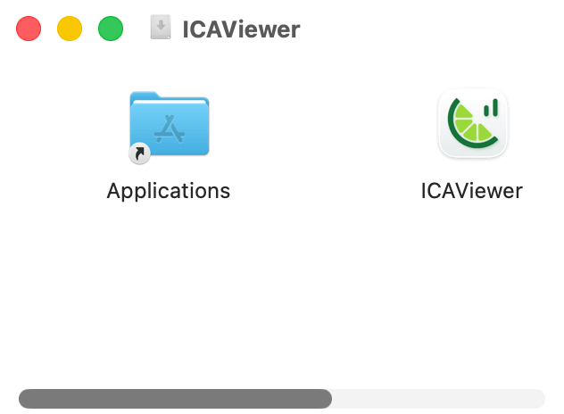

# 1. Installation

## What you need

- A Mac with macOS 14 (Sonoma) or later. Apple silicon and Intel Macs are both supported.
- The address of your organization's Citrix gateway or StoreFront store, and your account.

## Install the app

There are two ways. Use whichever you like; the app is the same.

### Option A: the disk image

1. Download the disk image `swift-ica-client-<version>.dmg` from the project's **Releases** page on GitHub. The release notes list its SHA-256 checksum; to check your download, open Terminal and run `shasum -a 256` on the file.
2. Double-click the disk image. A window opens with **ICAViewer** and a shortcut to **Applications**.
3. Drag **ICAViewer** onto **Applications**.



4. Eject the disk image (drag it to the Trash, or press the eject button next to it in the Finder sidebar).

### Option B: Homebrew

If you use [Homebrew](https://brew.sh), open Terminal and run:

```sh
brew install --cask janhaan/tap/icaviewer
```

This downloads the same signed and notarized app from the project's Releases page and puts it in **Applications**. Homebrew 7 loads casks only from taps you trust; the command above trusts this one app. To trust the whole tap instead, run `brew tap janhaan/tap && brew trust janhaan/tap`.

## First start

Open **ICAViewer** from **Applications** (or with Spotlight).

The app is signed with a Developer ID and notarized by Apple, so it opens like any other app downloaded from the internet. macOS may show one confirmation that the app was downloaded from the internet; click **Open**.

On the first start ICA Viewer shows the **Sign In** window ([Signing in](02-signing-in.md)). Nothing is read from your Mac, and no folder or device is shared, until you sign in and start an app. macOS asks for permission the first time a feature needs it:

- **Microphone**, the first time a remote app records ([Audio, microphone and webcam](08-audio-video.md)).
- **Camera**, the first time a remote app uses it.
- **Files and Folders**, when you share a folder or copy files.

> **If macOS refuses to open the app.** A build that is not notarized (for example one you built yourself) is blocked on its first start. Open **System Settings > Privacy & Security**, scroll down and click **Open Anyway** for ICAViewer. Alternatively, run `xattr -dr com.apple.quarantine /Applications/ICAViewer.app` in Terminal.

## Update

Quit ICA Viewer first. Homebrew does not quit a running app, and the old version keeps running until you quit it.

- **Disk image:** download the new disk image and drag **ICAViewer** to **Applications** again, replacing the old one.
- **Homebrew:** run `brew upgrade --cask icaviewer`.

Your settings and saved logins stay.

ICA Viewer does not check for updates by itself. Look at the Releases page now and then, or run `brew outdated --cask` if you installed it with Homebrew.

## Remove

1. Quit ICA Viewer.
2. Drag **ICAViewer** from **Applications** to the Trash. With Homebrew, run `brew uninstall --cask icaviewer` instead.
3. Optional: remove what it leaves behind. With Homebrew, `brew uninstall --zap --cask icaviewer` removes the app together with the settings, logs and caches below. It leaves the saved logins in the Keychain and your `~/Citrix Shared` folder alone.
   - Saved logins: open ICA Viewer first and use **Forget All Saved Credentials** in **Settings** ([Settings](12-settings.md)), or delete the entries for your store in **Keychain Access**.
   - Settings: `~/Library/Preferences/local.alttab.ICAViewer.plist`.
   - Logs, caches and the app data: `~/Library/Logs/ICAViewer`, `~/Library/Caches/ICAViewer` and `~/Library/Application Support/ICAViewer`.
   - The shared folder `~/Citrix Shared`, if you used it ([Client drives](06-drives.md)).
