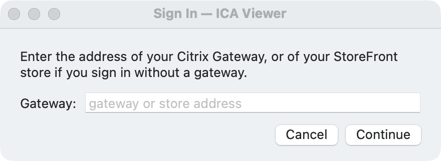
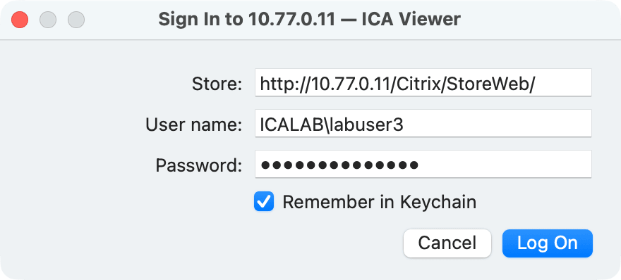
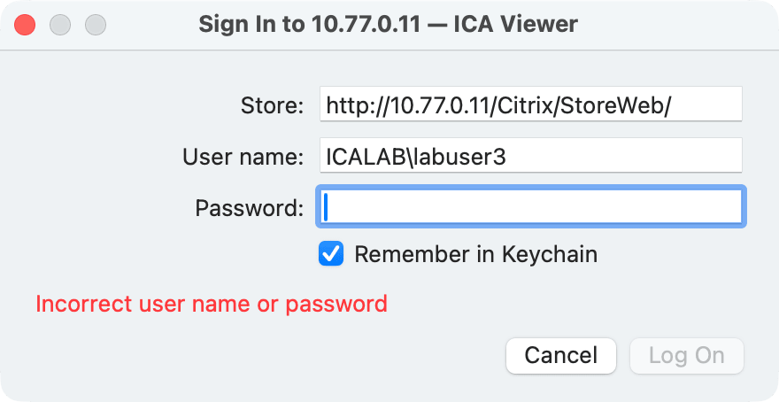
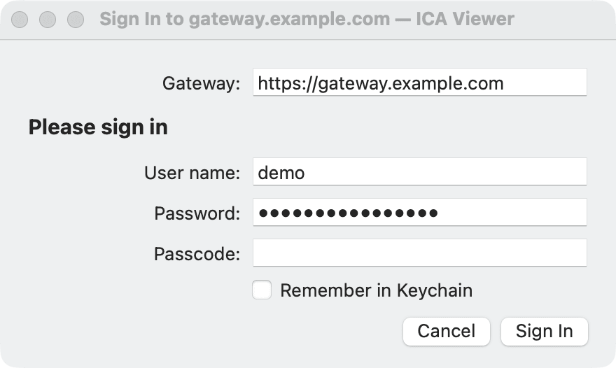

# 2. Signing in

ICA Viewer signs in to your organization's **gateway** (a Citrix Gateway, also called NetScaler Gateway) or directly to a **StoreFront** store. It builds the sign-in form from what the server asks for, so the fields you see depend on your organization.

## Gateway or StoreFront directly

Enter the address of a **gateway** and ICA Viewer signs in through it. Enter the address of a **StoreFront store** and it signs in to the store directly, without a gateway; this works the same way for you. Either way, the rest of this chapter applies.

## Enter the address

1. Open ICA Viewer. The **Sign In** window asks for the address. Its title is "Sign In — ICA Viewer"; once the address is known it reads "Sign In to *host* — ICA Viewer", which a password manager can match.
2. Type the address of your gateway (for example `gateway.example.com`) or of your store (for example `storefront.example.com/Citrix/StoreWeb`). You get this from your IT department.
3. Press Return or click **Continue**.

ICA Viewer contacts the server and shows its sign-in form. The address field moves to the bottom of the window, where you can still correct it. If the server cannot be reached, the window says so and offers **Try Again**.

## Sign in to a store

For a StoreFront store (directly, or through a gateway that only forwards to it) the form has a **User name** and a **Password**. Type them and press Return or click the default button (**Log On** for a store; the label comes from the server's form, so a gateway may say **Sign In**).

If the user name or password is wrong, the form stays open with the server's message. Check your entries and try again.

## Sign in through a gateway with a one-time code

Many gateways ask for more than a password: a one-time code from an authenticator app (TOTP) is typical. The gateway's own form decides which fields appear, for example **User name**, **Password** and **Passcode**. ICA Viewer shows them in the same window. Type the current code from your authenticator app into the **Passcode** field and click **Log On**.

The test lab has no gateway with a one-time code, so this picture is an illustration from the app's demo mode, with an example address and a made-up secret:

### Let ICA Viewer generate the code

If you do not want to type a code every time, ICA Viewer can generate it. On the first sign-in a **TOTP secret** field appears next to the **Passcode**. Paste the secret (the "setup key" your IT department or the authenticator enrollment shows, written in letters and digits) and ICA Viewer fills in the code from then on. The secret is stored in the Keychain and needs **Touch ID or your Mac password** whenever it is used. Click **Enter the code instead** to skip this and type the code yourself.

You can change this later in **Settings** ([Settings](12-settings.md#sign-in-and-saved-logins)): switch between typing the passcode at each sign-in and saving the secret, or look at the current code with **Show Current Code**.

## Save your login

Tick **Remember in Keychain** before you sign in. ICA Viewer then keeps your password in the macOS Keychain on this Mac (it never goes to iCloud) and signs you in without asking the next time.

- **Require Touch ID or the Mac password to use it** (in **Settings**) makes ICA Viewer ask for Touch ID or your Mac password before it reads the saved password.
- **Forget Saved Login** in the sign-in window, or **Forget All Saved Credentials** in **Settings**, deletes everything that was saved.
- A password the server rejected is never saved.

## Sign in again

If the app starts without a saved login, or the server asks you to sign in again, choose **File > Sign In…**.

Your sign-in at the server ends after a while without use (at a gateway often after about 90 minutes). While a session is connected, ICA Viewer keeps it alive (see [Privacy and security](16-privacy-security.md)), so this happens only when no session was open. When you next open an app, open the Connection Center or click its Refresh, ICA Viewer signs you in again by itself with the saved login (Touch ID or the Mac password may be asked) and carries on. Without a saved login, or if the server does not accept it, the sign-in window opens.

## Sign out

**File > Sign Out** ends your sign-in at the server (the store and, if you came through one, the gateway) and removes the sign-in cookies from your Mac. Sessions that are already open are not touched; they keep running. **Forget All Saved Credentials** in **Settings > Account** does the same and also deletes the saved password and TOTP secret.
