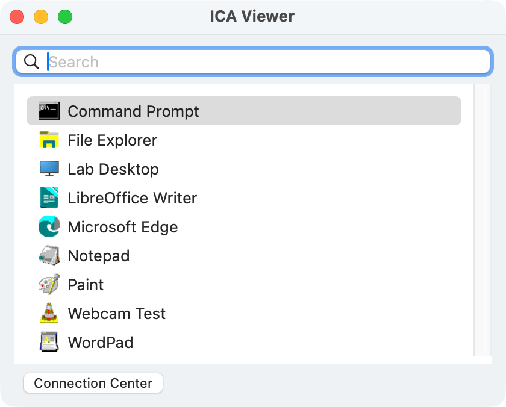
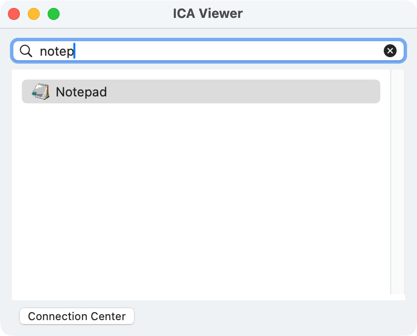
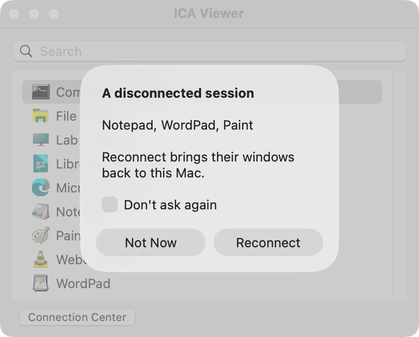

# 3. The launcher

After you sign in, the launcher lists the apps your organization published for you. The lab's list is short; yours can be long.

## Start an app

- Type in the **Search** field to filter the list. The first match is selected.
- Press **Return** to start the selected app, or **double-click** an app in the list.
- Press ↑ and ↓ to move through the list.

The line at the bottom shows what is happening ("Signing in…", "Opening Notepad…"). The first app of a session takes a few seconds, because the session has to start on the server. Further apps start inside the same session and are faster, without a second sign-in.

Each app opens in its own window; see [Working with remote apps](04-remote-apps.md).

## Bring the launcher back

The launcher closes when you start an app. To open it again:

- press **⌃⌥⌘L** from any app (you can change this shortcut in **Settings**),
- or click the ICA Viewer icon in the menu bar and choose **Open Launcher**,
- or choose **ICA Viewer > Show Launcher** (⌘L) while ICA Viewer is in front.

## Sessions that are still running

When you start ICA Viewer and a session is still open on the server (you disconnected earlier, or another Mac still shows it), the launcher offers to bring it back:

- **Reconnect** brings the session's windows back to this Mac.
- **Not Now** keeps the launcher as it is. Tick **Don't ask again** to stop the question (or switch it off and on in **Settings > General**, **Offer to reconnect disconnected sessions**); you can still reconnect from the [Connection Center](10-connection-center.md).

Running sessions are also listed at the bottom of the launcher, each with **Show**, **Disconnect** and **Log off**. The **Connection Center** button opens the full list.
