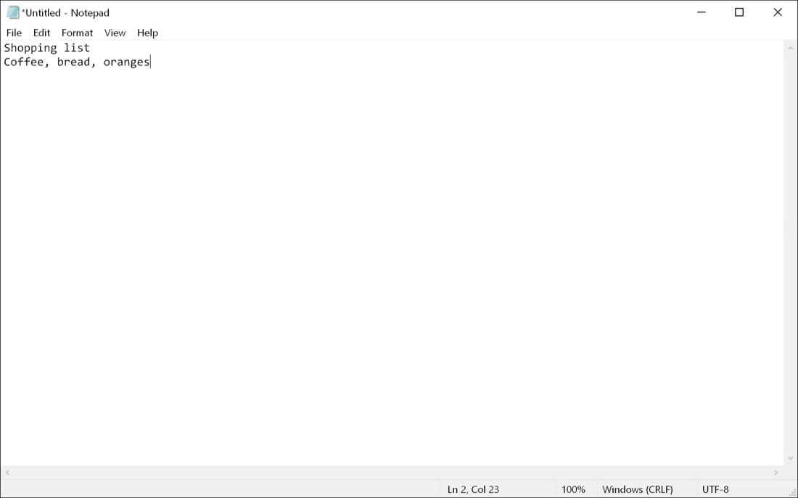
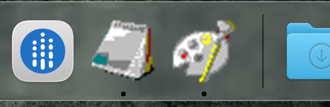
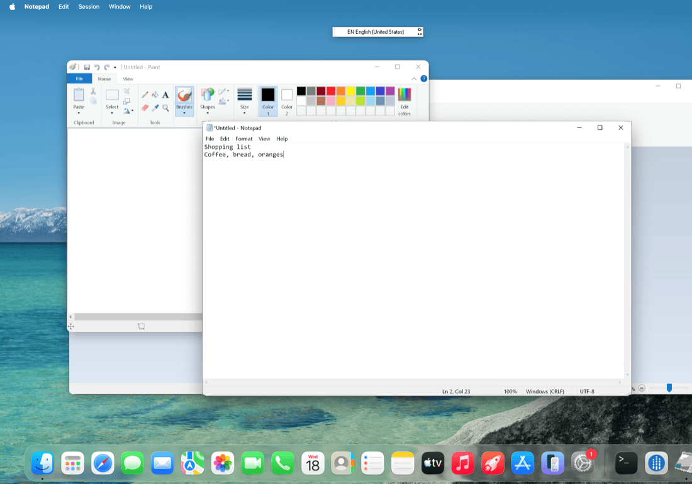
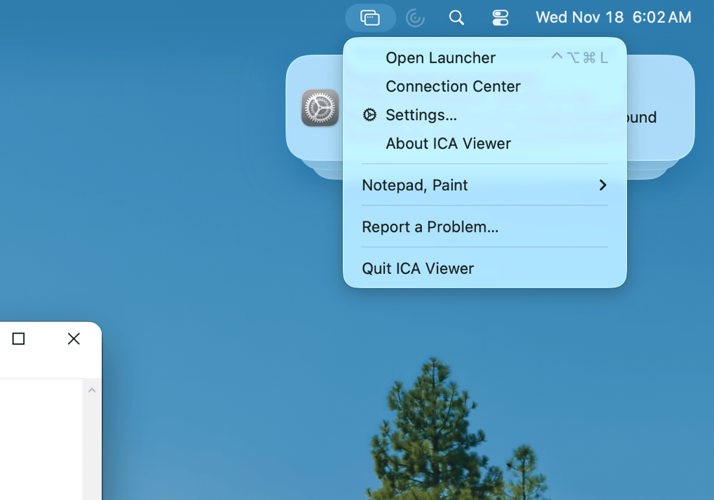
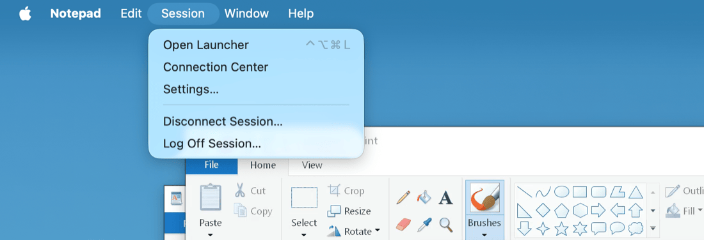
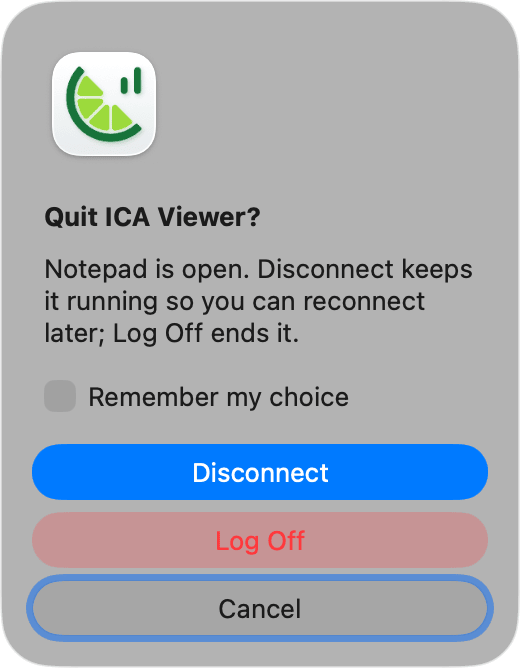

# 4. Working with remote apps

## Windows

Every window of a remote app is a real Mac window. You can move it, resize it, minimize it, put it on another Space or screen, and find it in Mission Control and in window switchers. Menus and drop-down lists of the remote app open as Mac windows too.

The title bar belongs to the remote app, so the buttons and the title are the ones Windows draws. Moving and resizing happens on your Mac at once and is passed on to the server afterwards.

## One Dock entry per app

Each remote app gets its own Dock icon and its own Cmd-Tab entry, with the app's real name and icon. If you start Notepad, WordPad and Paint, you see three icons.

While remote apps are open, ICA Viewer itself moves into the menu bar and leaves the Dock, so the Dock shows only your apps. Click its icon in the menu bar to open the launcher, the [Connection Center](10-connection-center.md) or [Settings](12-settings.md), to bring an app's window to the front, or to disconnect or log off a session.

If you prefer a single Dock icon for ICA Viewer, switch off **One Dock entry per app** in [Settings](12-settings.md#dock-and-launcher). Then the icon and the menu bar name follow the app you are using. The change applies the next time you start ICA Viewer.

## The menu bar

When a remote app is in front, the Mac menu bar shows that app's name, a small set of menus, and an extra **Session** menu.

The **Session** menu reaches the parts of ICA Viewer from inside an app:

- **Open Launcher**, **Connection Center** and **Settings…**
- **Disconnect Session…** and **Log Off Session…** for the session this app belongs to.

The **Edit** menu (Undo, Cut, Copy, Paste, Select All) sends the matching Ctrl key to the app. The **Help** menu has **ICA Viewer Help**, which opens the project's page on GitHub, and **Report a Problem…** ([Report a Problem](13-report-a-problem.md)).

## Open the launcher from anywhere

Press **⌃⌥⌘L** in any app to open the launcher, also when another Mac app is in front. In [Settings](12-settings.md#dock-and-launcher) you can pick **⌃⌥⌘K** or **⌃⌥⌘J** instead, or switch the shortcut off (the menu bar icon still opens the launcher).

## Quit one app

**⌘Q** in a remote app quits only that app. The Windows app behaves as if you closed its last window: it may ask whether to save, and then it ends. Other apps of the same session keep running. When the last app has quit, the session ends.

Closing a window with **⌘W** asks the remote app to close that window, as the close button does on Windows.

To quit ICA Viewer itself, use the menu bar icon > **Quit ICA Viewer**, or **ICA Viewer > Quit ICA Viewer** when ICA Viewer is in front. If a session is open, ICA Viewer asks what to do with it:

- **Disconnect** (the default) closes the windows on your Mac. The apps keep running on the server, so you can reconnect later and find your work as you left it.
- **Log Off** ends the session and closes its apps. Unsaved work in them is lost.
- Tick **Remember my choice** to stop being asked. You can change the answer later in **Settings > General** (**When quitting**).

## Using the keyboard

- **⌘ shortcuts are sent as Ctrl shortcuts.** ⌘C, ⌘V, ⌘X, ⌘A, ⌘Z and so on do what Ctrl+C and so on do in Windows. ⌘Q, ⌘H and ⌘M stay Mac shortcuts.
- **The Option key (⌥)** types special characters as on your Mac (for example @ or € on some layouts). Tapping ⌥ alone acts as the Windows Alt key, for example to reach the menu bar of a Windows app.
- **Keyboard layout.** ICA Viewer tells the server which layout your Mac uses when you sign in (German, US, UK, French, Swiss, Dutch, Spanish, Italian, Dvorak and more). If you switch the Mac's input source during a session, ICA Viewer sends the characters you type as text, so they stay right. Shortcuts follow the letter (⌘Z stays Undo) and the + and - keys (⌃+ and ⌃- stay zoom); other shortcuts use key positions.
- **Accents and emoji.** Dead keys work as on your Mac (^ then e gives ê, ⌥N then n gives ñ). **Edit > Emoji & Symbols** (⌃⌘Space) inserts the emoji you click; typing into its search field does not work there. Holding a key down for the accent menu does not work: the key repeats, as in Windows.
- More in [Keyboard shortcuts](15-shortcuts.md).

## Links open on your Mac

When you click a link in a remote app, it can open in your Mac's default browser instead of a browser on the server. Your IT department decides whether the server hands links over (the Citrix policy "Host to client redirection"); ICA Viewer has no setting for it.

- Only web links (**http** and **https**) open on your Mac. Everything else, such as mail links, file paths or links to other programs, opens on the server as before.
- A link to a server your Mac cannot reach (for example an intranet address while you are at home) opens on the server instead.
- If an app opens many links at once, ICA Viewer opens at most five in 30 seconds on your Mac; the rest open on the server.
- In a full desktop, links always open on the server.

## Full desktops

A published *desktop* (such as the lab's "Lab Desktop") opens in one ordinary window with the resource's name. The window has a fixed size (90 % of your main screen), cannot be resized, and does not span several screens. Closing the window disconnects the session; the desktop keeps running and you can reconnect from the launcher or the [Connection Center](10-connection-center.md).
