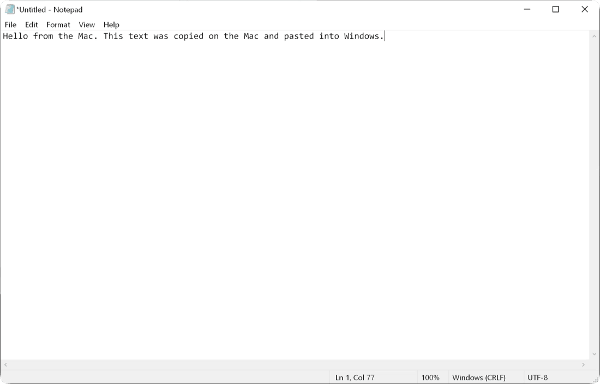
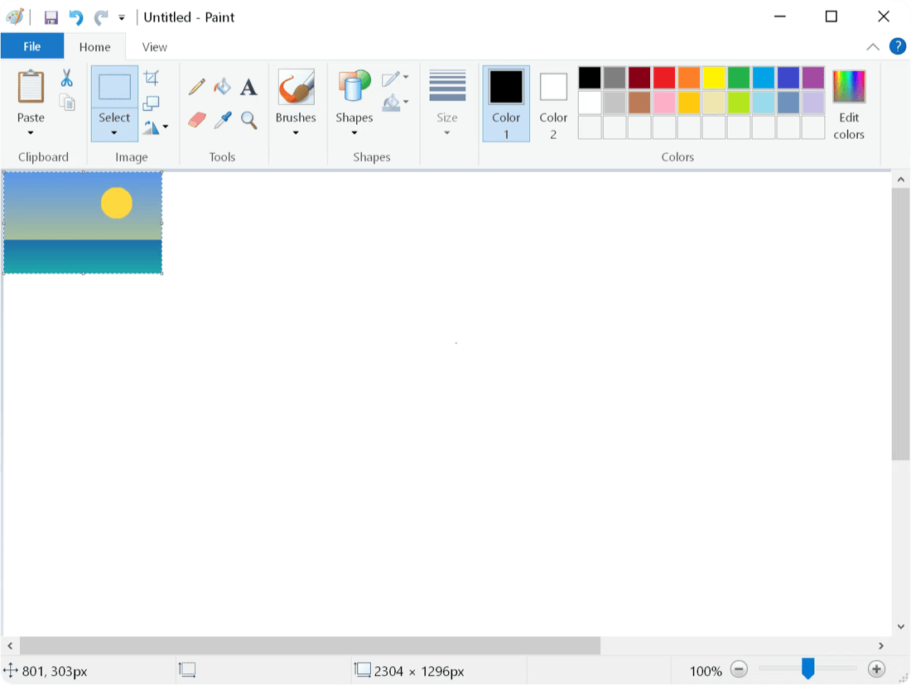
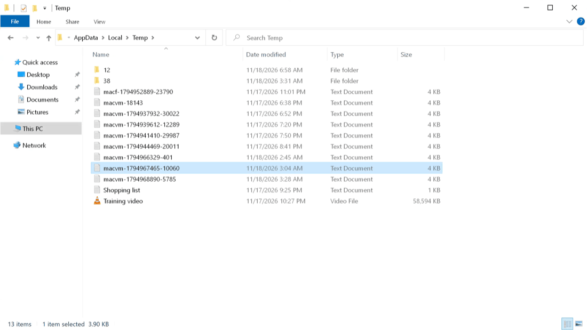
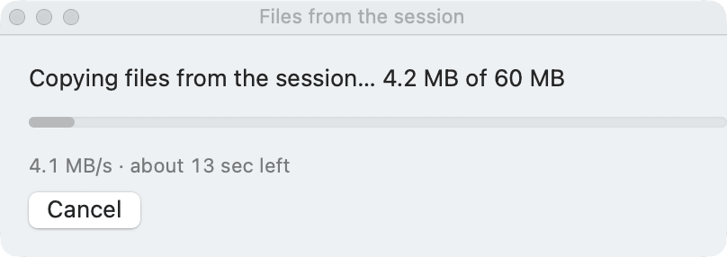

# 5. The clipboard

The Mac clipboard and the clipboard of your remote apps are connected. Copy in a Mac app and paste in a remote app, or the other way round. Use the usual shortcuts: **⌘C** and **⌘V** in a remote app are sent as Ctrl+C and Ctrl+V.

## Text

Copy text on the Mac, switch to a remote app, and paste.

Copying text in a remote app puts it on the Mac clipboard in the same way. The clipboard is handed over when you paste, so a very fast copy followed by an immediate paste in another app can show the older content; wait a second and try again.

## Pictures

Copy a picture on the Mac (for example from Preview, or a screenshot to the clipboard with ⌃⇧⌘4) and paste it into a remote app that accepts pictures, such as Paint. Pictures also travel from the session to the Mac.

## Formatted text

Formatted text (bold, colors, lists, and pictures inside it) is passed as rich text when both apps support it, in both directions. It was checked with WordPad and LibreOffice Writer. Which formatting survives depends on the two apps. If the receiving app cannot take the formatting, you get plain text. HTML (for example copied from a web page) is usually filtered by the server, so you get plain text.

## Files and folders

You can copy files between Finder and the remote File Explorer, in both directions, with the normal copy and paste commands. Folders work too.

- **Mac to session.** Select files in Finder, press **⌘C**, switch to File Explorer (or another Windows app that accepts files) and press **⌘V** (Ctrl+V). The files are read from your Mac while Windows copies them.

- **Session to Mac.** Select files in File Explorer, press Ctrl+C, switch to Finder and press **⌘V**. The files are stored on your Mac and the Finder shows them. Files that come from the session carry the macOS quarantine flag, so macOS checks them before it opens them the first time.

The feature is on by default. You can turn it off in [Settings](12-settings.md#clipboard) (**Copy files through the clipboard**). It applies from the next time you connect.

### Large files and progress

- Up to about 50 MB, the paste waits until the files have arrived. A small progress bar at the top of the screen shows how far it is.
- Larger copies from the session are fetched in the background as soon as you copy them. A window **Files from the session** shows the progress, and you can keep working. When it says the files are ready, paste them in Finder. **Cancel** stops the copy.

- Above a size limit (10 GB by default), ICA Viewer asks before it starts. You can change the limit in **Settings**, **Ask above 1, 5, 10 or 50 GB**, or **Never ask**. Copies from the Mac to the session stop at this size.
- How fast it is depends on the server: some servers pace file transfers, so a copy can be slow however fast your network is.
- ICA Viewer checks that your Mac has enough free disk space first, and refuses the copy otherwise.
- At most 1,000 files and folders are copied at once. Links and unreadable items on the Mac are left out, and ICA Viewer tells you.

## What the server may block

Your organization decides which of these the server allows. If a feature is blocked by the server's policy, ICA Viewer tells you once with a notice, and the [Connection Center](10-connection-center.md#features-the-server-refuses) lists it for the session ("Clipboard: blocked by server policy"). Copy and paste then simply does nothing in that direction. Ask your IT department if you need it.

## If something does not paste

- Try plain text first to see whether the clipboard connection works at all.
- Check that the file or folder is in the *selection* of the app you copy from before you press the copy shortcut.
- Check that the feature is not blocked by the server (Connection Center).
- A changed Mac clipboard replaces what you copied in the session. If you copy something else on the Mac while a large copy runs, ICA Viewer finishes the copy but does not overwrite your new clipboard.
