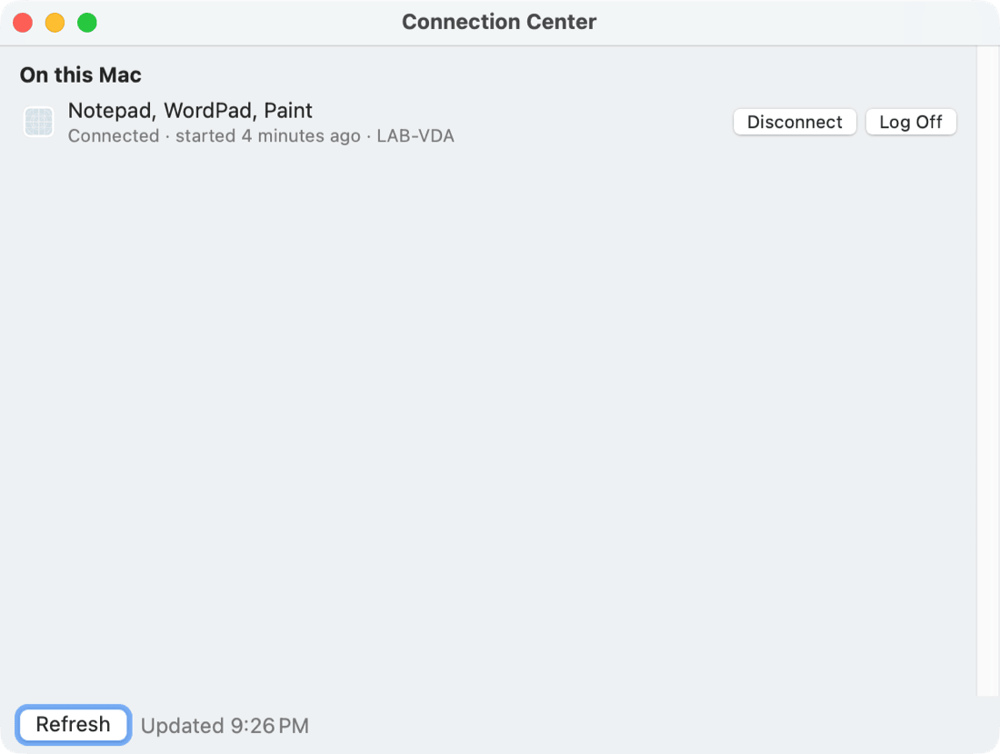
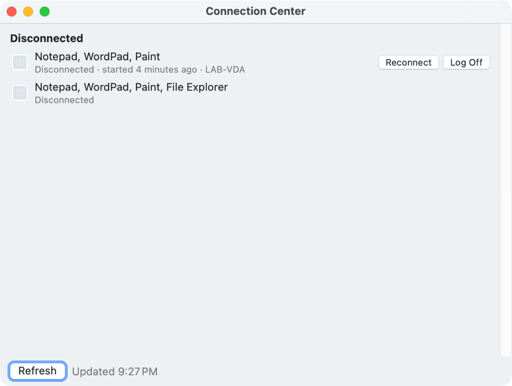
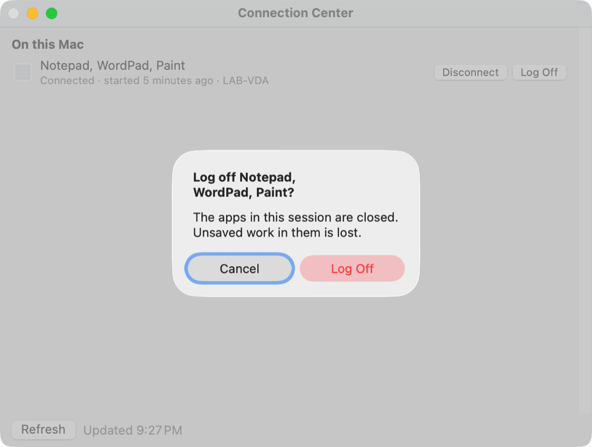

# 10. The Connection Center

The Connection Center lists your sessions and lets you reconnect, disconnect or log off. Open it from the launcher (**Connection Center**), from the menu bar icon, from the **Session** menu of a remote app, or with **⇧⌘C**.

## What you see

Sessions are grouped:

- **On this Mac**: sessions that this copy of ICA Viewer shows. "Connected" means its windows are open; "Connected – no visible windows" means the session is connected but has no window right now (for example after you closed all windows).
- **Disconnected**: sessions that are still running on the server but not shown anywhere. Your apps are still open there.
- **On other devices**: sessions the server shows as connected from another computer.

Each line shows the app names and when the session started.

## Actions

| Button | What it does |
|---|---|
| **Show** | Brings the windows of a connected session back to the front |
| **Disconnect** | Closes the windows on this Mac. The apps keep running on the server |
| **Log Off** | Ends the session and closes its apps. Asks first; unsaved work is lost |
| **Reconnect** | Brings a disconnected session back to this Mac |
| **Take Over…** | Moves a session from another device to this Mac. The other device loses it |
| **Reconnect All** | Reconnects every disconnected session |
| **Refresh** | Asks the server for the current list. The status line under the list shows when it was last updated |

Logging off asks for confirmation, because unsaved work in the apps is lost:

**Disconnect is the safe choice.** Your apps and documents stay where they are, and you can reconnect from this Mac or another one.

## Related settings

**Settings > General** ([Settings](12-settings.md#when-quitting-and-at-sign-in)) has **When quitting** (what **Quit ICA Viewer** does with open sessions: **Ask**, **Disconnect** or **Log Off**) and **Offer to reconnect disconnected sessions** (see [The launcher](03-launcher.md#sessions-that-are-still-running)).

## Features the server refuses

Your organization's server decides which redirections a session may use. If it refuses one that ICA Viewer asked for, the session's line in the Connection Center lists it, for example:

- Clipboard: blocked by server policy
- File copy: blocked by server policy
- Client drives: blocked by server policy
- Printing: blocked by server policy
- Audio: blocked by server policy

The first time you try to use a blocked feature in a session, ICA Viewer also shows a short notice, for example "The server's policy blocks the clipboard for Notepad." These are not faults of your Mac; only your IT department can change the policy. The lab user used for the screenshots in this manual has no blocked features, so none appear above.
