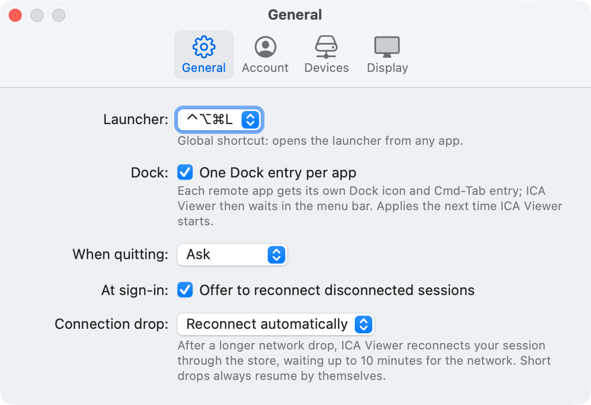
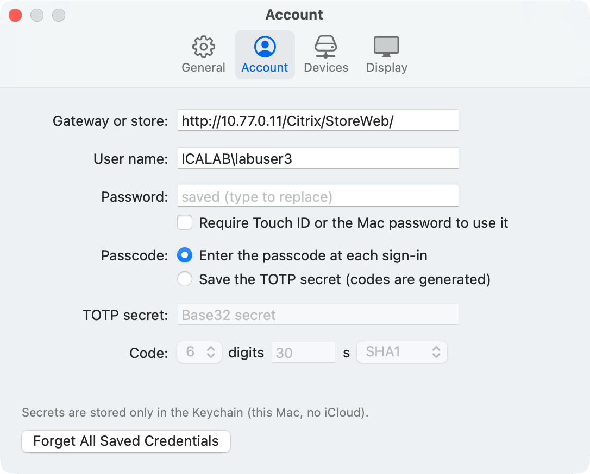
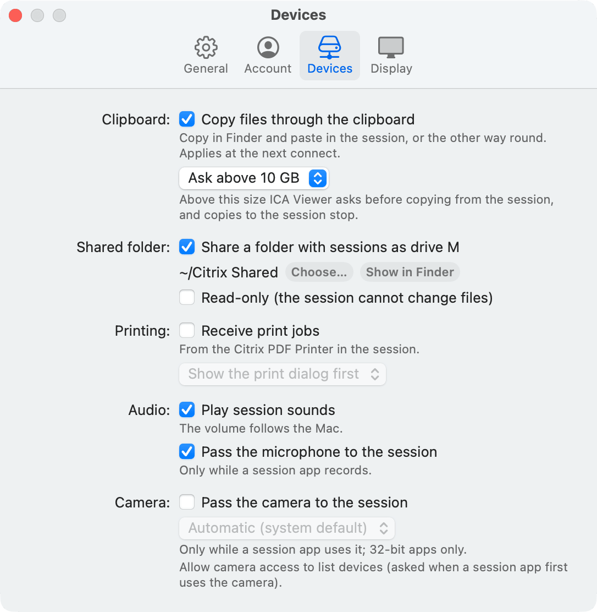
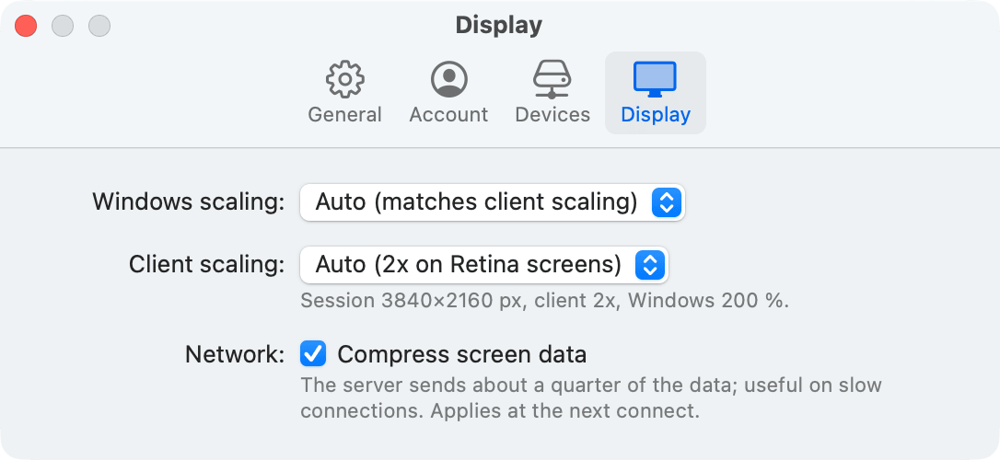

# 12. Settings

Open **Settings** with **⌘,** (while ICA Viewer is in front), from **ICA Viewer > Settings…**, from the menu bar icon, or from the **Session** menu of a remote app.

Settings has four panes in a toolbar: **General**, **Account**, **Devices** and **Display**. The window's title shows the pane you are in, and ICA Viewer remembers the last pane. There is no Save button: **every change applies at once**. A few settings take effect only the next time you connect or start ICA Viewer; the hint under each says so.

## General

### Dock and launcher

- **Launcher** (the shortcut): the global shortcut that opens the launcher from any app: ⌃⌥⌘L (default), ⌃⌥⌘K, ⌃⌥⌘J or **Off**. If another app already uses the shortcut, Settings says so; choose another one.
- **One Dock entry per app** (on by default): each remote app has its own Dock icon and ⌘-Tab entry, and ICA Viewer waits in the menu bar. Switch it off to get one Dock icon whose name and icon follow the active app. Applies the next time ICA Viewer starts.

### When quitting and at sign-in

- **When quitting**: what **Quit ICA Viewer** does with open sessions: **Ask** (default), **Disconnect** or **Log Off**. See [Working with remote apps](04-remote-apps.md#quit-one-app).
- **At sign-in: Offer to reconnect disconnected sessions** (on by default): when you start ICA Viewer and sessions are still running on the server, ask whether to reconnect them ([The launcher](03-launcher.md#sessions-that-are-still-running)).

### Connection drop

- **Connection drop**: **Reconnect automatically** (default) or **Ask**. This is what happens after a longer network drop; short drops are always bridged by themselves. See [Session reliability](11-reliability.md).

## Account

### Sign-in and saved logins

- **Gateway or store**: the address you signed in to. Change it to point ICA Viewer at another server.
- **User name** and **Password**: your saved login. The password field shows "saved (type to replace)" when one is stored; type a new one to replace it. Settings never shows a saved password or secret.
- **Require Touch ID or the Mac password to use it**: ICA Viewer asks for Touch ID or your Mac password before it reads the saved password.
- **Passcode**: choose **Enter the passcode at each sign-in** (you type the one-time code each time) or **Save the TOTP secret (codes are generated)** (ICA Viewer calculates the code itself).
- **TOTP secret** and the line of **digits**, seconds and algorithm (SHA1, SHA256, SHA512): the details of the one-time code. The defaults (6 digits, 30 seconds, SHA1) are what almost every authenticator uses; change them only if your IT department says so.
- **Show Current Code**: shows the code ICA Viewer calculates now, after Touch ID or your Mac password. Use it to check the secret.
- **Forget All Saved Credentials**: deletes the saved password and TOTP secret for the server.

Secrets are stored only in the Keychain on this Mac, never in iCloud. See [Signing in](02-signing-in.md).

## Devices

### Clipboard

- **Copy files through the clipboard** (on by default): copy in Finder and paste in the session, or the other way round. Applies at the next connect.
- **Ask above 1, 5, 10 or 50 GB, or Never ask**: above this size ICA Viewer asks before it copies files from the session, and copies from the Mac to the session stop at this size. See [The clipboard](05-clipboard.md).

### Client drive

- **Share a folder with sessions as drive M**, with **Choose…**, **Show in Finder** and **Read-only (the session cannot change files)**. See [Client drives](06-drives.md).

### Printing

- **Receive print jobs** (off by default): from the Citrix PDF Printer in the session. A list below chooses what happens with a job: **Show the print dialog first** or **Open in Preview first**. See [Printing](07-printing.md).

### Audio and camera

- **Play session sounds** (on by default). The volume follows the Mac.
- **Pass the microphone to the session** (on by default): only while a session app records; macOS asks the first time. See [Audio, microphone and webcam](08-audio-video.md).
- **Pass the camera to the session** (on by default), with a list of cameras (**Automatic (system default)** or a named camera). Only while a session app uses it; macOS asks the first time. See [Audio, microphone and webcam](08-audio-video.md).

## Display

### Scaling

- **Windows scaling**: **Auto (matches client scaling)** or 100 % to 200 %.
- **Client scaling**: **Auto (2x on Retina screens)**, **1x** or **2x**.
- A line below shows what the session used. If you change scaling while a session is open, a note says that open sessions keep their scaling until they reconnect, with a **Reconnect Now** button; your apps keep running. See [Displays and scaling](09-displays.md).

### Network

- **Compress screen data** (on by default): the server sends about a quarter of the data; useful on slow connections. Applies at the next connect.

## Language

ICA Viewer shows English or German, following your Mac's language (**System Settings > General > Language & Region**). There is no setting inside the app.
