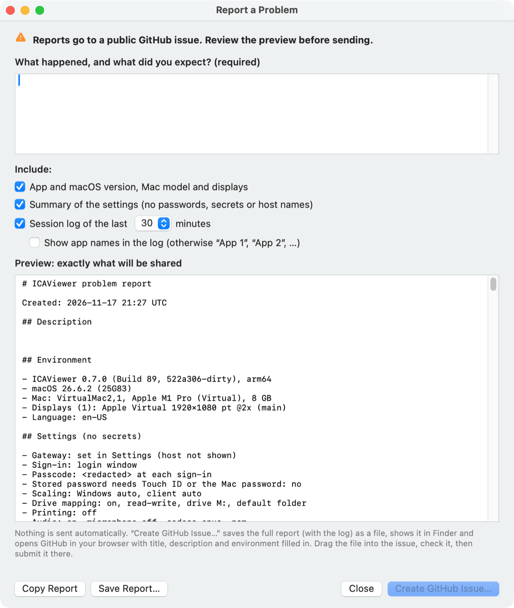

# 13. Report a Problem

If something does not work, you can send a report to the project. The report is built on your Mac, **nothing is sent automatically**, and you see exactly what it contains before anything leaves your Mac.

Open it with **Help > Report a Problem…** (also in the menu bar icon menu).

## Fill it in

1. Describe **what happened and what you expected**. This is required.
2. Choose what to include:
   - **App and macOS version, Mac model and displays**
   - **Summary of the settings** (no passwords, secrets or host names)
   - **Session log of the last** 10, 30 or 60 minutes
   - **Show app names in the log** (otherwise they appear as "App 1", "App 2", …)
3. Read the **Preview**. It is exactly what will be shared. ICA Viewer already replaces gateway and store host names, user names, IP addresses, tokens, tickets, e-mail addresses, home folder paths and (by default) app names. Still, read it, and remove anything you do not want to share from your description.

## Send it

- **Copy Report** puts the text on the clipboard.
- **Save Report…** saves it as a file.
- **Create GitHub Issue…** saves the full report (with the log) as a file, shows it in Finder, and opens a prefilled issue in your browser. Drag the saved file into the issue.

**GitHub issues are public.** Everyone can read what you post. Check the preview and the file before you send.

ICA Viewer also keeps a log of your sessions for yourself in `~/Library/Logs/ICAViewer`. That log is not scrubbed and is readable only by you. Do not post it as is.
