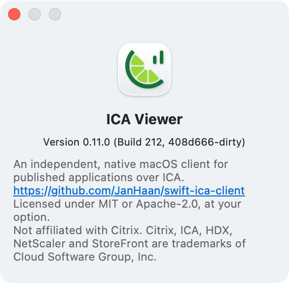

# 14. Troubleshooting and FAQ

## Signing in

**"Cannot reach the gateway" or "Cannot reach the store".**
Check the address for typing errors and that you are on the right network (some organizations need the company VPN or office network). Click **Try Again**. If it still fails, open the address in Safari: if the page does not load there either, the problem is the network, not ICA Viewer.

**"The gateway did not accept the sign-in. Check your entries."**
The user name, password or one-time code was wrong. One-time codes change every 30 seconds; type the current one. If you let ICA Viewer generate codes, check that your Mac's clock is set automatically (**System Settings > General > Date & Time**): a wrong clock produces wrong codes. In **Settings**, **Show Current Code** shows what ICA Viewer calculates.

**It asks for Touch ID every time.**
That is **Require Touch ID or the Mac password to use it** and the TOTP secret's protection. Turn the first off in **Settings > Account** if you do not want it for the password; a saved TOTP secret always needs Touch ID or your Mac password.

**ICA Viewer forgot my login.**
Logins are saved only when **Remember in Keychain** is ticked, and never after a rejected password. If you changed the server address, the saved login belongs to the old address.

## Apps

**An app does not start, or "could not be opened".**
Try again. If the server says it refused another session for your user, you may have a session open on another device: look in the [Connection Center](10-connection-center.md) and use **Take Over…** or **Log Off**.

**I do not see any apps in the launcher.**
Your account may have none assigned, or the sign-in did not finish. Choose **File > Sign In…** and try again, or ask your IT department.

**An app opened in the same session as another one.**
That is normal: apps of the same user share one session, which is why the second app starts quickly and needs no new sign-in. ICA Viewer shows a message when a particular app has to run in the session of another.

**"This server accepts only UDP connections (HDX over UDP), and UDP does not get through on this network."**
Your organization's server is set to connect over UDP only, and the network you are on blocks UDP. Try another network, or ask your IT department to open the UDP port the message names. When the server also allows TCP, ICA Viewer falls back to it by itself.

**A link opens in a browser on the server, not on my Mac.**
That happens when the server does not hand links over (ask your IT department about the Citrix policy "Host to client redirection"), when the link is not a web link, when your Mac cannot reach its server, or after many links in a short time. Some apps open links in the server's default browser directly; those always stay on the server.

**A window is on a screen that is gone.**
Use the **Session** menu or the Connection Center to disconnect and reconnect; the windows return on your current screens.

**The picture is blurry.**
Check **Client scaling** in **Settings > Display**: **1x** is blurry on Retina screens. **Auto** is sharp, unless the session would be too large; **Settings** then explains why 1x is used ([Displays and scaling](09-displays.md)).

## Clipboard and files

**Paste does nothing.**
See [The clipboard](05-clipboard.md#if-something-does-not-paste). The server may block the clipboard: look at the session's line in the Connection Center.

**Copying files from the session does not start.**
Check that **Copy files through the clipboard** is on in **Settings > Devices** and that you connected after turning it on.

## Network and sessions

**My windows are dimmed with a countdown.**
The connection was lost. Wait; the session continues when the network is back ([Session reliability](11-reliability.md)).

**My apps are gone after I woke the Mac.**
The server ended the session while the Mac slept. Start the apps again from the launcher. Disconnect, rather than quit, before you close the lid for a long time.

**I quit ICA Viewer and my apps are still running.**
Quit asks **Disconnect** or **Log Off**. Disconnect keeps the apps running on the server. Reconnect from the launcher or Connection Center, or log off there.

## Other

**Why does the app not use the Dock icon for itself?**
While remote apps are open, ICA Viewer lives in the menu bar and each app has its own Dock icon. See [Working with remote apps](04-remote-apps.md#one-dock-entry-per-app).

**Which languages does it support?**
English and German, following the Mac's language.

**Is it a replacement for the official Citrix Workspace app?**
No. It is an independent project, tested against a limited set of servers. Some features of the official app are missing: for example smart card or SAML sign-in, USB devices, and UDP transport through a gateway. If you depend on those, use the official app.

**Where are the logs?**
`~/Library/Logs/ICAViewer`. Do not post them as they are; use [Report a Problem](13-report-a-problem.md), which removes names and addresses.

## Which version do I have?

Choose **ICA Viewer > About ICA Viewer** (or the same item in the menu bar icon menu). The panel shows the version, the build and the commit. Include them when you ask for help.

## Still stuck

Use **Help > Report a Problem…**. A good report says what you did, what you expected and what happened.
