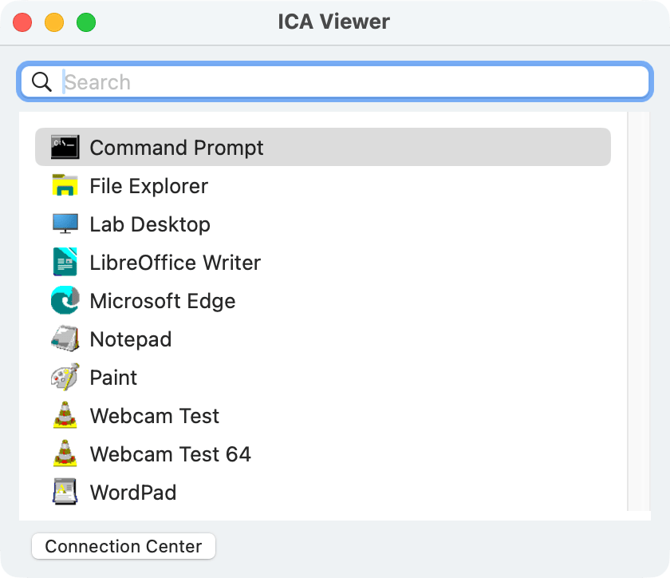

# ICA Viewer User Manual

Version <!-- version -->0.9.0<!-- /version -->

ICA Viewer is a Mac app for working with Windows apps that your organization publishes through Citrix. Each remote app opens in its own Mac window, with its own Dock icon, and works with Cmd-Tab, Mission Control and your window switcher like any local app.

This manual shows what the app does today. It is regenerated for every release, and the screenshots come from a test lab (a lab server, the lab user `labuser3`, and the lab apps Notepad, WordPad, Paint, File Explorer and LibreOffice Writer). Your organization's apps and server will look different.

> ICA Viewer is an independent project and is not affiliated with Citrix. It is not a replacement for the official client; read [Privacy and security](16-privacy-security.md) and [Troubleshooting](14-troubleshooting.md) before you rely on it.

## Quick start

1. Install the app: open the disk image and drag **ICAViewer** to **Applications** ([Installation](01-installation.md)).
2. Open it and enter your gateway or store address, then your user name and password ([Signing in](02-signing-in.md)).
3. Type in the launcher to find an app and press Return ([The launcher](03-launcher.md)).
4. Work in the app's window. Press ⌃⌥⌘L at any time to bring the launcher back ([Working with remote apps](04-remote-apps.md)).

## Chapters

| Chapter | What it covers |
|---|---|
| [1. Installation](01-installation.md) | The disk image, first start, requirements, updating and removing |
| [2. Signing in](02-signing-in.md) | Gateway with one-time code, StoreFront directly, saving your login, Touch ID |
| [3. The launcher](03-launcher.md) | Finding and starting apps, reconnecting to running sessions |
| [4. Working with remote apps](04-remote-apps.md) | Windows, Dock entries, menu bar, ⌃⌥⌘L, quitting one app |
| [5. The clipboard](05-clipboard.md) | Text, pictures, formatted text, files, large copies, what the server may block |
| [6. Client drives](06-drives.md) | Sharing a Mac folder with the session |
| [7. Printing](07-printing.md) | Print jobs from Windows on your Mac |
| [8. Audio, microphone and webcam](08-audio-video.md) | Sound, recording and the camera |
| [9. Displays and scaling](09-displays.md) | Retina sharpness, Windows scaling, several screens |
| [10. The Connection Center](10-connection-center.md) | Reconnect, disconnect, log off, features the server refuses |
| [11. Session reliability and automatic reconnect](11-reliability.md) | What happens when the network drops |
| [12. Settings](12-settings.md) | Every option explained |
| [13. Report a Problem](13-report-a-problem.md) | Sending a report without leaking secrets |
| [14. Troubleshooting and FAQ](14-troubleshooting.md) | Common problems and answers |
| [15. Keyboard shortcuts](15-shortcuts.md) | All shortcuts in one table |
| [16. Privacy and security](16-privacy-security.md) | What is stored, what leaves your Mac |

## Conventions

- Names of buttons, menu items and settings are in **bold**. A path such as **ICA Viewer > Settings…** means: open the **ICA Viewer** menu, then choose **Settings…**.
- Keys are written with the Mac symbols: ⌘ (Command), ⌃ (Control), ⌥ (Option), ⇧ (Shift).
- Screenshots marked *Illustration* come from the app's demo mode with example data, because the situation (for example a gateway sign-in with a one-time code, or a network drop) cannot be shown on demand in the test lab.
- The app follows your Mac's language: English or German.
